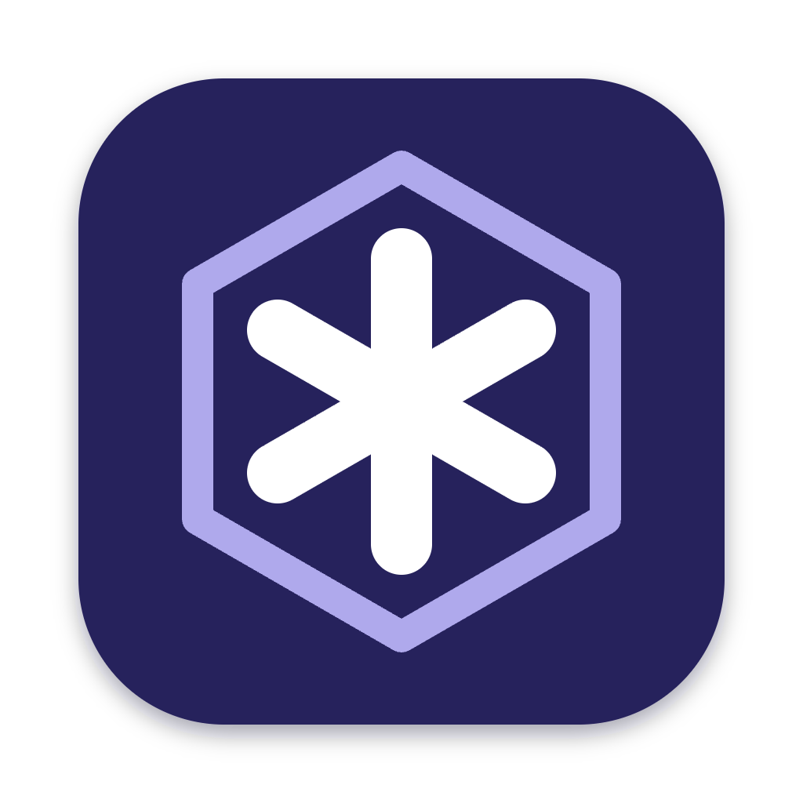

<div align="center">



# Rove

**A browser that belongs to you: fast, private, and built to be shaped by you.**

Windows · macOS · Linux

[](https://github.com/Gabbo65/rove/actions/workflows/ci.yml) [](https://github.com/Gabbo65/rove/actions/workflows/codeql.yml) [](https://github.com/Gabbo65/rove/releases/latest) [](LICENSE)

[Download](#download) · [Why](#why-rove) · [Features](#features) · [Phone remote](#phone-remote) · [Shortcuts](#keyboard-shortcuts) · [Security](#security) · [Roadmap](#roadmap) · [Build from source](#build-from-source) · [License](#license)

</div>

---

## Download

Pick your system, download, open. That's it.

| System | Download | Notes |
|---|---|---|
| **Windows** (most PCs) | [Rove-win-x64.exe](https://github.com/Gabbo65/rove/releases/latest/download/Rove-win-x64.exe) | Installer |
| Windows on ARM (Surface Pro X, Copilot+ PCs) | [Rove-win-arm64.exe](https://github.com/Gabbo65/rove/releases/latest/download/Rove-win-arm64.exe) | Installer |
| **macOS** with Apple chip (M1 or newer) | [Rove-mac-arm64.dmg](https://github.com/Gabbo65/rove/releases/latest/download/Rove-mac-arm64.dmg) | Drag to Applications |
| macOS with Intel chip | [Rove-mac-x64.dmg](https://github.com/Gabbo65/rove/releases/latest/download/Rove-mac-x64.dmg) | Drag to Applications |
| **Linux**, any distribution | [Rove-linux-x86_64.AppImage](https://github.com/Gabbo65/rove/releases/latest/download/Rove-linux-x86_64.AppImage) | Portable, no install |
| Ubuntu / Debian / Mint | [Rove-linux-amd64.deb](https://github.com/Gabbo65/rove/releases/latest/download/Rove-linux-amd64.deb) | Package |
| Linux on ARM (Raspberry Pi 4/5, ARM laptops) | [AppImage](https://github.com/Gabbo65/rove/releases/latest/download/Rove-linux-arm64.AppImage) · [.deb](https://github.com/Gabbo65/rove/releases/latest/download/Rove-linux-arm64.deb) | |

All versions and release notes: **[Releases](https://github.com/Gabbo65/rove/releases)**

> **Not sure which one?**
> **Windows:** take the first one.
> **Mac:** open the Apple menu → *About This Mac*. "Apple M…" means Apple chip; "Intel" means Intel.
> **Linux:** the AppImage works everywhere.

### First launch

The app isn't signed with a paid Apple / Microsoft certificate yet, so your system asks once whether you trust it:

- **Windows:** "Windows protected your PC" → click **More info** → **Run anyway**.
- **macOS:** right-click the app → **Open** → **Open**. If macOS says the app "is damaged", run this once in Terminal:
  ```bash
  xattr -cr "/Applications/Rove.app"
  ```
- **Linux (AppImage):** make it executable (right-click → *Properties* → *Allow executing*), or run:
  ```bash
  chmod +x Rove-linux-*.AppImage
  ```
  To save passwords on Linux you need a keyring (GNOME Keyring or KWallet). Most desktops have one already.

---

## Why Rove

Most browsers are built around someone else's priorities: an account to sign into, a store to sell through, a feed to keep you scrolling, settings you aren't allowed to touch.

**Rove is built around one idea: freedom.** To rove is to wander freely, anywhere, and that's the point. It's your tool, so you should be able to see how it works, change how it looks and behaves, and make it do things no other browser lets you do.

- **No account, no cloud, no tracking.** Your history, favorites and passwords stay on your computer.
- **Open and readable.** Plain JavaScript, no hidden services. If you can read code, you can read all of it.
- **Made to be changed.** The goal is a browser you can reshape completely: layout, behavior, and what runs on the pages you visit.
- **Powerful by default.** Features usually hidden behind extensions or developer menus are first-class here, starting with the [phone remote](#phone-remote).

This is an early version. The core browser is solid and tested; the deep customization described in the [roadmap](#roadmap) comes next.

---

## Features

### Browsing
- **Tabs:** drag to reorder, pin, search (with recently closed ones), and duplicate. Each tab runs in its own process.
- **Sleeping tabs:** tabs you haven't looked at for a while free their memory and wake up on click, back/forward history included.
- **Undo closing:** reopen closed tabs, or a whole closed window, in order and in place, with their history.
- **Smart address bar:** suggestions from your history, favorites and open tabs, with inline completion and optional search-engine suggestions.
- **Favorites bar:** drag to reorder, rename, or show just the icon.
- **Find in page**, **zoom**, **downloads** with progress, and full **history** with search.

### Privacy & security
- **InPrivate windows:** no history, separate cookies, and everything wiped when the window closes.
- **Encrypted passwords and addresses:** locked with your system's key (macOS Keychain, Windows account, Linux keyring). If no secure key store exists, the browser won't save passwords at all.
- **Safe autofill:** fills only after a real click from you; scripts on a page can't trigger it.
- **Passkeys:** not supported yet. Sites are told so immediately and fall back to the password option, so they don't hang.
- **Locked-down pages:** web pages can't reach the browser's own pages, settings or toolbar.
- **Asks before opening other apps:** links like `mailto:` ask first; USB, serial and Bluetooth device requests are refused.

### Comfort
- **Light / dark theme**, or follow your system.
- **Search engine of your choice**, including a custom one.
- **Settings page** for start page, downloads, passwords, sleeping tabs, privacy and updates.
- **Update check:** tells you when a new version is out.

---

## Phone remote

Control the browser from your phone over your home Wi-Fi. Nothing to install on the phone.

1. Click the **remote button** in the toolbar (or press `⇧⌘Q` / `Ctrl+Shift+Q`) to show a QR code.
2. Scan it with your phone's camera. Your phone and computer must be on the same Wi-Fi.
3. The first time, your phone warns about the connection's certificate: the browser makes its own private certificate for your network. Accept it to continue.

The remote is meant for your own trusted Wi-Fi: anyone with the QR link can control the browser.

Two modes:

- **Basic:** buttons and a trackpad. Switch tabs, open favorites, go back/forward, scroll, click, type into the page, and open any address.
- **Advanced:** a live mirror of the page on your phone, with live video when your network allows it, or picture-by-picture as a fallback. A badge on the phone shows which one is active.

---

## Keyboard shortcuts

| Action | macOS | Windows / Linux |
|---|---|---|
| **Tabs & windows** | | |
| New tab | `⌘T` | `Ctrl+T` |
| Close tab | `⌘W` | `Ctrl+W` |
| Reopen closed tab / window | `⇧⌘T` | `Ctrl+Shift+T` |
| Next tab | `⌃Tab` | `Ctrl+Tab` |
| Previous tab | `⌃⇧Tab` | `Ctrl+Shift+Tab` |
| Go to tab 1–8 | `⌘1` … `⌘8` | `Ctrl+1` … `Ctrl+8` |
| Go to last tab | `⌘9` | `Ctrl+9` |
| Search tabs | `⇧⌘A` | `Ctrl+Shift+A` |
| New window | `⌘N` | `Ctrl+N` |
| New InPrivate window | `⇧⌘N` | `Ctrl+Shift+N` |
| Close window | `⇧⌘W` | `Ctrl+Shift+W` |
| **Navigation** | | |
| Go to address bar | `⌘L` | `Ctrl+L` |
| Back | `⌘[` | `Ctrl+[` |
| Forward | `⌘]` | `Ctrl+]` |
| Reload | `⌘R` | `Ctrl+R` |
| Reload without cache | `⇧⌘R` | `Ctrl+Shift+R` |
| Stop loading | `⌘.` | `Ctrl+.` |
| **Page** | | |
| Find in page | `⌘F` | `Ctrl+F` |
| Next / previous match | `⌘G` / `⇧⌘G` | `Ctrl+G` / `Ctrl+Shift+G` |
| Zoom in / out / reset | `⌘=` / `⌘-` / `⌘0` | `Ctrl+=` / `Ctrl+-` / `Ctrl+0` |
| Full screen | `⌃⌘F` | `F11` |
| **Favorites, history & more** | | |
| Add page to favorites | `⌘D` | `Ctrl+D` |
| Show / hide favorites bar | `⇧⌘B` | `Ctrl+Shift+B` |
| History | `⌘Y` | `Ctrl+Y` |
| Downloads | `⇧⌘J` | `Ctrl+Shift+J` |
| Show / hide phone QR code | `⇧⌘Q` | `Ctrl+Shift+Q` |
| Settings | `⌘,` | `Ctrl+,` |
| Developer tools | `⌥⌘I` | `Ctrl+Alt+I` |
| Quit | `⌘Q` | `Alt+F4` (Windows) · `Ctrl+Q` (Linux) |

**In the address bar:** `↑` `↓` choose a suggestion · `Enter` open it · `⌘`/`Ctrl` + `Enter` open in a background tab · `Tab` accept the inline completion · `Shift+Delete` remove a history suggestion · `Esc` cancel.

**With the mouse:** `⌘`-click (Mac) or `Ctrl`-click (Windows / Linux) on a favorite, history entry or suggestion opens it in a background tab. Middle-click a favorite to do the same; middle-click a tab to close it.

---

## Security

Tabs are sandboxed, the browser's own UI can't be reached by web pages, passwords are encrypted by your system, and release builds are locked down. All the details, and how to **report a vulnerability privately**, are in **[SECURITY.md](SECURITY.md)**. What changed in each version: **[CHANGELOG.md](CHANGELOG.md)**.

---

## Roadmap

The direction is simple: **everything about the browser should be yours to change.**

- **Full customization:** rearrange and restyle the interface, themes, toolbar layout, and per-site behavior.
- **Hex:** Rove's built-in toolkit for people who like to take things apart.
  - **Script injection:** run your own JavaScript and CSS on the sites you choose, to fix, automate or reshape any page.
  - **Power tools:** for inspecting and experimenting with how websites work. Details to come.
- **Phone remote, hardened:** stronger pairing and encryption before it's recommended outside your home network.
- **Signed installers** and automatic in-app updates.

Ideas and feedback are welcome in [Issues](https://github.com/Gabbo65/rove/issues).

---

## Build from source

Requires [Node.js](https://nodejs.org) 22 or newer and Git.

```bash
git clone https://github.com/Gabbo65/rove.git
cd rove
npm install
npm start
```

| Command | What it does |
|---|---|
| `npm start` | Run the browser from source |
| `npm test` | Full test suite: starts the real app with a throwaway profile, offline, about 1 minute |
| `npm run test:compact` | Only the tests listed in `test/compact.txt`, for quick checks while working |
| `npm test -- passwords` | Only tests whose file or name contains "passwords" |
| `npm run dist` | Build installers for your current system into `release/` |
| `npm run install-app` | macOS: run all tests, build the app and copy it to /Applications |
| `npm run update-engine` | macOS: upgrade Electron (Chromium), run all tests, reinstall only if they pass |

Every push is tested on macOS, Windows and Linux. Pushing a version tag (`v0.2.0`) builds the installers for all three and attaches them to a draft release.

<details>
<summary><b>Project layout</b></summary>

```
main.js                 entry → src/main/app.js
src/main/               main process
  app.js                startup order, shared actions
  window.js / tab.js    a window (UI + tabs); each tab is its own WebContentsView
  windows.js            all windows + glue (favorites, downloads, remote, settings)
  db.js                 SQLite (node:sqlite), schema migrations
  history.js favorites.js closed.js downloads.js settings.js
  suggest.js            address-bar suggestions
  passwords.js autofill.js   encrypted passwords + form data (Electron safeStorage)
  settings-page.js      pb://settings backend
  remote.js stream.js   phone remote (HTTPS + WebSocket) and live mirror (WebRTC)
  updates.js            update checks (GitHub Releases, or the engine when run from source)
  migrate.js            one-time import from the first version
  rename.js             one-time move of data + saved passwords from the old name (Personal Browser)
  protocol.js ipc.js menu.js permissions.js urls.js paths.js
src/preload/            the only bridges into pages (allow-listed)
src/ui/chrome/          browser UI (pb://chrome)
src/ui/hud/             find bar, QR code and notices over the page
src/ui/pages/           pb://newtab, history, settings, error
remote/index.html       the phone page
test/                   test runner, local test web server, specs
.github/workflows/      tests on 3 systems; release builds
```

</details>

Built with [Electron](https://www.electronjs.org) (Chromium + Node.js).

---

## License

Rove is free software, released under the **[GNU General Public License v3.0](LICENSE)** (or any later version).

You may use, study, share and change it. If you share a modified version, it has to stay free under the same license, so every copy of Rove stays open for the people who use it.

Rove comes with no warranty. See the [LICENSE](LICENSE) for the full terms.
